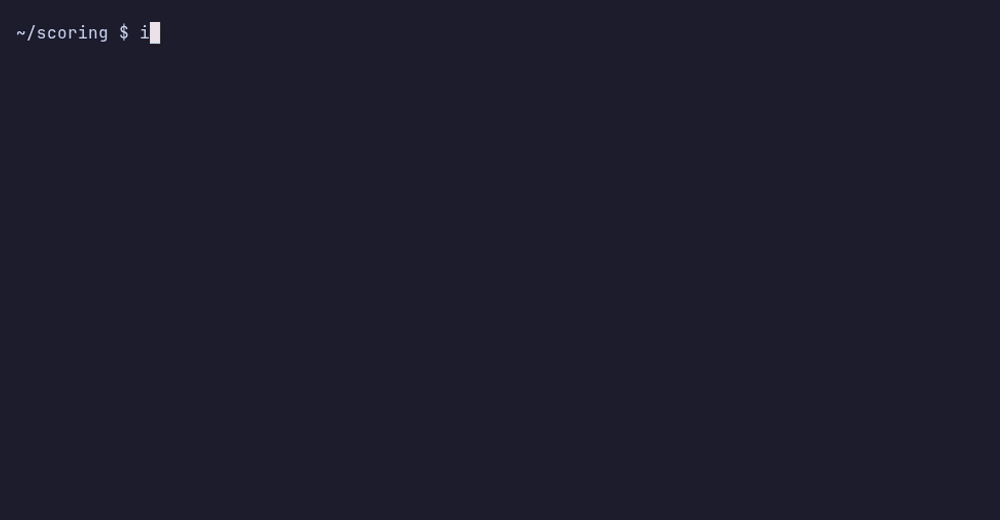

# igc-sync

Keeps a local folder in sync with an event's IGC flight files on [gliding.net.nz](https://gliding.net.nz), so SeeYou live scoring can watch it. Runs on Windows, macOS and Linux. No login needed.



## Usage

Download the binary for your platform from the [latest release](../../releases/latest), then run it from the folder SeeYou watches:

```sh
cd /path/to/seeyou/watch/folder
igc-sync
```

Pick an event with the arrow keys and press Enter; the list shows the last 5 events and the next 10, starting on the one closest to today. Files land in `./{event-slug}/{filename}.igc`. Leave it running: it checks again every 60 seconds (Enter checks now), and `q` quits.

Each check compares every remote file's SHA-256 with the local copy, downloads new and changed files (e.g. a corrected re-upload), and discards any download whose hash doesn't match.

## Development

Requires Go 1.26+ (see `go.mod`).

```sh
go test ./...                              # unit tests
go test -tags live ./internal/live/        # real anonymous GETs against gliding.net.nz (CI runs these too)
git config core.hooksPath .githooks        # block direct pushes to main
go run .
```

Set `IGC_SYNC_NOW=YYYY-MM-DD` to pretend it's another day when choosing which events to list. Cross-compile with `GOOS`/`GOARCH`, e.g. `GOOS=windows GOARCH=amd64 go build .`

Requests go to `GET /api/v1/events/{id}/igc-files` with `User-Agent: igc-sync/<version>` so a WAF can allow it. Relates to [glidingnz/58gliding.net.nz#231](https://github.com/glidingnz/58gliding.net.nz/issues/231).

The demo GIF is recorded with [VHS](https://github.com/charmbracelet/vhs); see [docs/demo.tape](docs/demo.tape) to regenerate it.

## Releasing

Versions follow [SemVer](https://semver.org/). The public API is everything an organiser's setup relies on: how it's run, where files land and what they're called, and the supported platforms.

| Bump | When |
|---|---|
| Major | An existing setup breaks: a different output folder or filenames, a dropped platform, a new required step |
| Minor | New capability; existing setups unaffected |
| Patch | Bug fixes, and Go dependency bumps worth shipping (e.g. a security fix) |
| None | Tests, CI, docs and GitHub Actions bumps; the binary doesn't change |

Weekly Dependabot bumps accumulate on `main` until there's a reason to ship. Release well before a competition, not during one: organisers download the binary once and leave it running.

With CI green on `main`:

```sh
gh release create vX.Y.Z --target main --generate-notes
```

(or **Releases → Draft a new release** on GitHub, new tag, target `main`, **Generate release notes**, **Publish**).

The [Release workflow](.github/workflows/release.yml) then tests, builds all four platform binaries with the tag embedded, and attaches them within a few minutes. If it fails, fix `main` and re-run the workflow; the release itself can stay.
